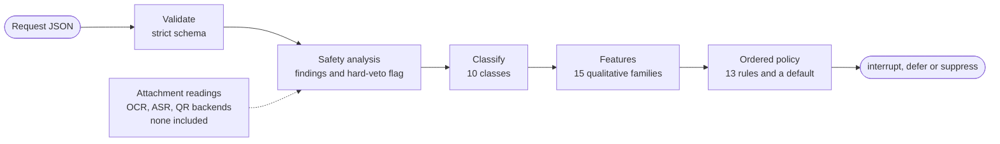

# multimodal-message-router

A command-line program that decides what an incoming chat message should do to
the reader's notifications: **interrupt** now, **defer** until later, or be
**suppressed**.

This is an independent portfolio implementation. It began with a hackathon
problem about WhatsApp-style message notifications (August 2026) and was then
expanded. It is not an official submission, has no connection to the event's
organisers, and contains no data from it. Every example message here is
fictional.

**Where to start**

* A short plain-English overview for any reader follows directly below.
* [For Technical Reviewers](#for-technical-reviewers) is the
  engineering detail: architecture, routing policy, safety design, commands,
  tests and limitations.

### The problem

People receive many messages. Some deserve attention now, some can wait, and some
are suspicious or unsafe, like a fake helpdesk asking for a code. Scams often
fake urgency so that you act before you think.

### The idea

The program reads a message and the context it has, such as who sent it and what
kind of chat it came from, and decides how it should affect the reader's
notifications.

### Three decisions

* **INTERRUPT**: bring an important, time-sensitive, relevant message to the
  reader's attention now.
* **DEFER**: keep useful but less urgent content for later review.
* **SUPPRESS**: prevent unnecessary or unsafe interruptions. It does not delete a
  message, block an account or report a sender; the program only prints a
  decision.

(The program prints them as `interrupt`, `defer` and `suppress`.)

### Three fictional examples

| Message | Decision | Why |
|---|---|---|
| Building facilities, in a one-to-one chat: "Fire alarm in the main office building. Everyone please evacuate now and meet at the car park." | **INTERRUPT** | A genuine safety alert that arrives directly, with no sign of a trick. |
| A friend: "Lunch on Friday? I booked the usual table at the cafe by the river for twelve thirty." | **DEFER** | Useful, but not urgent. |
| Someone posing as a helpdesk: "Hello, this is the helpdesk. Please send me the one time code you just received so I can verify your account." | **SUPPRESS** | Asking for a one-time code is a common account-takeover trick, and safety rules outrank everything else. |

These come from `examples/urgent.json`, `examples/benign.json` and
`examples/credential_request.json`. The first interrupts partly because it
arrives in a one-to-one chat; the same words in a group chat are deferred,
because the program cannot tell whether they are meant for this reader.

### How it decides

1. Read the message and the available context.
2. Look for suspicious requests and risks: codes, passwords, payments, deceptive
   links.
3. Check how relevant the message is and how urgent it really is.
4. Apply ordered rules, safety rules first, so a serious warning sign settles
   the outcome before anything else counts.
5. Choose INTERRUPT, DEFER or SUPPRESS, and record which rule decided.

### Why safety comes first

Scams imitate emergencies. Urgent-sounding words like "act now" do not earn an
interrupt on their own, and a request for a one-time code or password is stopped
from interrupting at all. The checks are fixed text patterns tuned to English, so
they miss some scams and promise no perfect protection (see
[known limitations](#known-limitations)).

### What this is today

* A working command-line prototype in Python, with fictional examples only. It is
  not connected to WhatsApp or any live service.
* The image and voice-note examples use prepared text standing in for OCR (text
  read from an image) and ASR (speech-to-text) output. No image is opened, no
  audio is decoded and no such engine is included; these are plug-in points, not
  finished integrations.
* It does not yet learn from a reader's past behaviour, and it gives no
  confidence score or written explanation, only the rule that decided.

### Why it is interesting

Interrupt too easily and people ignore alerts; stay too quiet and a real fire
alarm waits in a pile. And some senders imitate urgency on purpose. Balancing
usefulness, urgency, safety and interruptions, with every decision traceable to a
rule, is the problem this project explores.

## For Technical Reviewers

Everything from here on is the engineering reference, and it can be read without
the overview above.

A deterministic, policy-based router that decides whether an incoming message
should **interrupt** the reader now, **defer** until later, or be
**suppressed**, treating text, image-derived text and voice-derived text as
untrusted input.

It is written in standard-library Python with no dependencies, runs from a
single command, and every decision carries an inspectable trace: a policy
identifier and a set of content-free findings.

Find it quickly:

* Architecture and the pipeline diagram: [How it works](#how-it-works), and
  [docs/architecture.md](docs/architecture.md) for trust boundaries and media
  handling.
* Policy order and precedence: [docs/routing-policy.md](docs/routing-policy.md).
* Safety layer: [Engineering design highlights](#engineering-design-highlights)
  and [docs/threat-model.md](docs/threat-model.md).
* Commands and six runnable demonstrations: [Quickstart](#quickstart) and
  [Demonstrations](#demonstrations).
* Test evidence and hosted CI: [Testing and CI](#testing-and-ci).
* Limitations and tradeoffs: [Known limitations](#known-limitations).

## The problem

A notification system that treats all messages alike either buries the urgent
one or interrupts for noise. Worse, messages are written by other people, and
some of those people want to be treated as urgent: a fake helpdesk asking for a
one-time code, a "courier" demanding a fee at a strange link. Routing is
therefore a safety problem as well as a ranking problem.

This project makes the safety decision explicit. Message content, including
text read out of an image or a voice note, is data to be analysed and never an
instruction to be followed. The route is chosen by a short, ordered, readable
policy rather than a learned score, so any decision can be traced to the rule
that made it.

## What it does

| Capability | What it means here |
|---|---|
| Strict input | One versioned JSON request document. Unknown fields are rejected, and the format has no field for an action or score, so a document cannot dictate its own outcome. |
| Safety analysis | Pattern-based findings across 11 categories (credential requests, coercive payment, deceptive links, prompt injection and others) at three severities. Findings carry a rule id, category, severity and provenance, never the matched text. |
| Classification | 10 message classes, with ambiguity kept rather than forced. |
| Features | 15 feature families with qualitative levels, where `unknown` is deliberately different from `absent`. |
| Ordered routing | 13 ordered policies plus a default. The first match selects one of `interrupt`, `defer` or `suppress`. |
| Hard veto | A severe finding forces `suppress`, and no later rule is consulted. |
| Provenance | Authored text, OCR text, speech transcripts and decoded codes are tracked separately and never gain instruction authority. |
| Replaceable extraction | OCR, ASR and QR are interfaces. No recognition engine is included. |
| CLI | `validate` checks a document loads. `route` prints one JSON decision. |

## How it works



A request is validated into typed objects, any attachment readings are
collected from whatever backends the caller supplies, and the pipeline runs
safety analysis, then classification, then feature extraction, then the policy.
The `route` command supplies no backends, so it reads no images and transcribes
no audio. The full diagram, with trust boundaries and the three ways media can
be handled, is in [docs/architecture.md](docs/architecture.md). The policy
itself is in [docs/routing-policy.md](docs/routing-policy.md).

## Engineering design highlights

* **A veto, not a weight.** The hard veto is the first policy. When it applies,
  no later predicate runs, which a test enforces by replacing every later rule
  with one that raises. Trust, relevance or urgency are never weighed against a
  severe finding.
* **No scoring in the routing policy.** The policy compares qualitative levels
  by rule. A structural test scans the files of the routing package and fails
  on addition, subtraction, multiplication, division or a `sum`, `max` or `min`
  call, so a sufficiently "positive" feature cannot outweigh a risk. (The
  classifier does add up small support ranks internally to pick a message
  class; that tally is not a routing score and no action is derived from it.)
* **Corroboration counts causes, not repetition.** Two findings that express
  the same underlying indicator count once, so the same demand read from typed
  text and from OCR text cannot corroborate itself.
* **Untrusted by construction.** Every provenance is recorded and none can
  carry instruction authority or confer verified trust. Tests iterate the whole
  enumeration to prove it.
* **Honest about what it could not read.** A failed or unavailable reading
  marks the analysis incomplete. It is never treated as evidence of safety.
* **Deterministic and bounded.** No randomness, clock, network or model call.
  Safety analysis reads at most 20,000 characters of each source. Anything past
  that is flagged as unread, never counted as safe, and cannot by itself earn
  an interrupt. Tests confirm that inputs with tens of thousands of repeated
  separators complete promptly.
* **Claims are tested.** Documentation tests check that links resolve, diagrams
  show the stages in the order the code calls them, and the tables and JSON
  excerpts here match what the router prints.
* **A public-tree audit.** `scripts/audit_public_tree.py` keeps data files,
  media, secrets, local paths and build artefacts out of the repository, and
  runs in CI.

## Quickstart

Requires Python 3.10 or newer. It was developed and tested with Python 3.12 and
needs no packages. Run from the repository root; nothing needs installing.

```bash
PYTHONPATH=src python -m message_router --help
PYTHONPATH=src python -m message_router route --help
PYTHONPATH=src python -m message_router validate examples/benign.json
PYTHONPATH=src python -m message_router route --input examples/credential_request.json
```

On Windows PowerShell:

```powershell
$env:PYTHONPATH = "src"
python -m message_router --help
python -m message_router route --input examples/credential_request.json
```

The last command prints one JSON decision and exits `0`. Invalid input exits
non-zero with an error that names a stage and a location in the document, never
a value from it.

If you want an installed copy, install from a copy of `pyproject.toml` and
`src/` made outside the checkout, which is what CI does. Installing from inside
the checkout, editable or not, leaves `build/` and `src/*.egg-info` behind.
Both are git-ignored, but the public-tree audit fails until they are deleted.

## Demonstrations

Six fictional messages, each a runnable command. Details, scenarios and JSON
excerpts are in [docs/demo.md](docs/demo.md).

| Example | Action | Policy | Classification |
|---|---|---|---|
| `examples/benign.json` | `defer` | `route.utility.safe_defer` | `scheduled_event` |
| `examples/urgent.json` | `interrupt` | `route.urgency.safe_interrupt` | `safety_alert` |
| `examples/credential_request.json` | `suppress` | `route.safety.hard_veto` | `suspicious_content` |
| `examples/suspicious_payment.json` | `suppress` | `route.safety.hard_veto` | `suspicious_content` |
| `examples/ocr_example.json` | `suppress` | `route.safety.hard_veto` | `suspicious_content` |
| `examples/asr_example.json` | `suppress` | `route.safety.hard_veto` | `suspicious_content` |

The first four use `route` directly:

```bash
PYTHONPATH=src python -m message_router route --input examples/benign.json
PYTHONPATH=src python -m message_router route --input examples/urgent.json
PYTHONPATH=src python -m message_router route --input examples/credential_request.json
PYTHONPATH=src python -m message_router route --input examples/suspicious_payment.json
```

The last two need the example runner, because the request format has no field
for extracted text:

```bash
PYTHONPATH=src python examples/run_media_examples.py --input examples/ocr_example.json
PYTHONPATH=src python examples/run_media_examples.py --input examples/asr_example.json
```

These two use **pre-extracted synthetic OCR and ASR text**: fixed fictional
strings supplied through the project's OCR and ASR interfaces, tagged with the
provenance a real engine's output would carry. No image is opened and no audio
is decoded. There is no OCR or speech engine in this repository. Run on its own,
`route` reports such an attachment as unread, defers, and sets
`analysis_incomplete` to `true`.

## Testing and CI

```bash
PYTHONDONTWRITEBYTECODE=1 python -m unittest discover -s tests -v
PYTHONDONTWRITEBYTECODE=1 python scripts/audit_public_tree.py
```

```powershell
$env:PYTHONDONTWRITEBYTECODE = "1"
python -m unittest discover -s tests -v
python scripts/audit_public_tree.py
```

The environment variable matters: some tests start subprocesses, and without it
Python writes `__pycache__` directories that the audit rejects. (`python -B`
alone is not enough, because it does not reach those subprocesses.)

The last complete run on the Windows development machine, at commit `882bf05`,
collected 1,060 tests: 1,054 passed and 6 were skipped, with no failures or
errors, and the audit reported no findings. The skips are environmental:
creating symbolic links needs a privilege that was not available there. The
count changes as tests are added, so run the suite to see the current figure.

These are **synthetic** tests. Inputs are fictional and the expected results
encode intended behaviour, covering domain contracts, the loader, each safety
rule family, the routing policy, structural guards (no scoring, no network
imports), the CLI and examples, the audit itself, and these documents. They
show that designed behaviour holds and that regressions are caught. They are
not an accuracy measurement: there is no labelled real-world corpus here, so
this project reports no accuracy, precision or recall.

A GitHub Actions workflow in `.github/workflows/ci.yml` runs the tests, the
audit and a CLI check on Ubuntu and Windows with Python 3.12. For commit
`822c30e` it ran on GitHub-hosted runners
([run 41354571865](https://github.com/adelcampovj/multimodal-message-router/actions/runs/41354571865)).
On both Ubuntu and Windows all 1,060 tests passed, none failed or were skipped,
and the audit reported no findings. Those results describe that commit only;
they are not a claim about any later one.

## Known limitations

* **A deterministic, policy-based prototype.** Detection is finite and
  pattern-based, tuned to English. It will miss paraphrases, other languages
  and novel phrasings, and a message with no findings has not been shown to be
  safe. It is not production-certified.
* **No recognition is included.** The media examples use pre-extracted
  synthetic text. Real OCR, ASR and QR integration needs external backends
  written against the existing interfaces, and the `route` command supplies none.
* **`history` is validated but unused.** The request format accepts history
  records, but they do not influence the decision.
* **`preferences` are used, narrowly.** A silenced conversation reaches
  feature extraction, and a silenced thread of established low value can be
  suppressed. Quiet hours are accepted and validated, but the `route` command
  supplies no local time, so the quiet-hours level stays `unknown` and changes
  no decision. `accepts_broadcast` is validated and not used. Preferences
  cannot soften a safety finding.
* **Some benign requests are suppressed.** A request for a document about
  credentials (for example a "password policy") is treated like a request for
  the credential itself. This fails toward caution and is not yet corrected.
* **Some anti-fraud warnings are suppressed.** "Never share your passwords with
  anyone" is read as a request, and so are the same sentences with "passcodes"
  and "OTPs", because the warning recognition is written around singular
  objects.
* **Long messages are only partly checked for safety.** Safety analysis reads
  at most 20,000 characters of each source (for example the typed body, or one
  transcript) and sets `analysis_incomplete` when it cuts one short. A finding
  inside that part still applies, and a severe one still vetoes first. A
  hostile request placed after that point is not recognised, and its absence
  from the findings does not mean it is safe. Classification still reads the
  whole text. Alert or outage wording that appears only past the limit cannot
  earn an interrupt, but an alert inside the analysed part still can, even if
  more text follows. Long messages are not
  all deferred or all suppressed: the outcome depends on what lies inside the
  analysed part.
* **No numeric confidence.** The decision exposes no calibrated confidence
  value.
* **No natural-language reason.** The decision exposes a policy id, findings
  and diagnostic codes, but no generated explanation.
* **Synthetic coverage is not real-world accuracy.** Passing tests do not say
  how well the rules would perform on real traffic.

## Future improvements

* Real OCR, ASR and QR adapters behind the existing interfaces, with the
  extracted text carried in the request or supplied by a runner.
* Letting a request supply "directly addressed" and "near-term event" context,
  and using `history` in routing, with tests that show the effect.
* A bounded way to tell a request for a credential from a request for a
  document about one, and warning recognition that covers plural objects.
* Human-readable reasons derived from the policy id and findings.
* Confidence values, only once there is labelled data to calibrate them against.

## Documentation

* [docs/architecture.md](docs/architecture.md): the pipeline, trust boundaries
  and layers, with diagrams.
* [docs/routing-policy.md](docs/routing-policy.md): the ordered policy, rule by
  rule.
* [docs/threat-model.md](docs/threat-model.md): the safety layer, what it
  detects, and what it deliberately does not.
* [docs/demo.md](docs/demo.md): the six demonstrations in detail.
