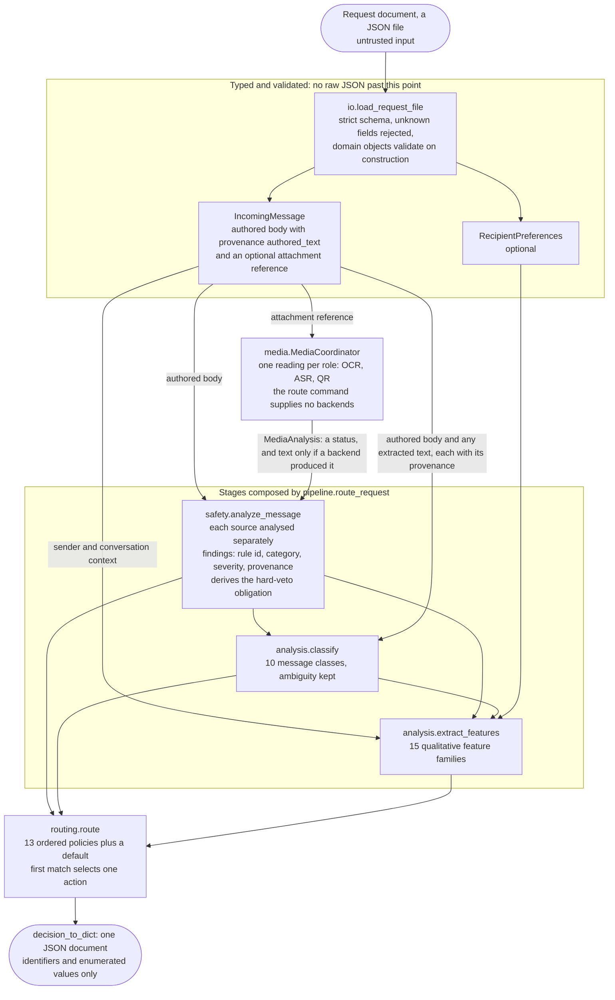
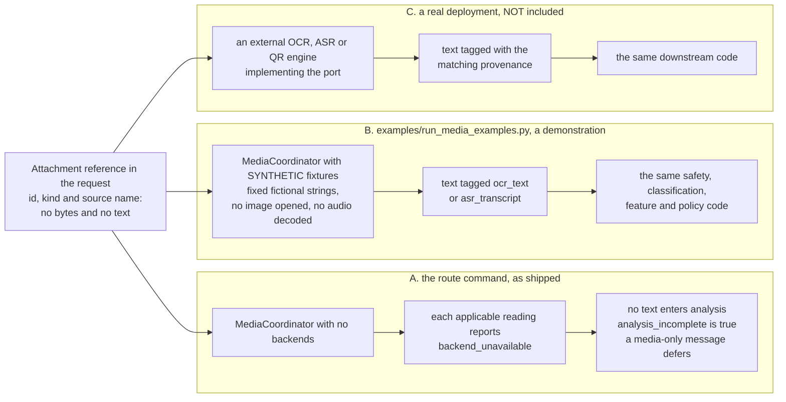

# Architecture

One request travels one fixed path: it is validated into typed objects,
optionally has attachment readings collected, is analysed for safety,
classified, turned into qualitative features, and finally passed through an
ordered routing policy that selects exactly one action: `interrupt`, `defer`
or `suppress`. Nothing in that path is learned, scored or random.

## The pipeline

This is what `python -m message_router route` does, in the order
`src/message_router/pipeline.py` calls the stages.

Reading the diagram:

* **Validation comes first and cannot be skipped.** The command line and the
  demonstration runner both reach the pipeline only through the loader, and an
  invalid document stops there with a non-zero exit status.
* **Safety runs before classification, and classification before features.**
  The policy receives all three results; the safety result alone can end the
  decision (the hard veto), because that rule is evaluated first.
* **Preferences enter at feature extraction only.** The safety stage does not
  accept them, so they cannot soften a finding.
* **The request's `history` records are validated by the loader but are not
  part of this path.** Nothing on the route path reads them.

## Images and voice

The request document has no field for extracted text, so what happens to an
attachment depends on which backends the caller supplies. Three situations
exist; only the first two are in this repository.

The synthetic fixtures in B are not an OCR or speech-recognition engine. They
return a fixed, fictional string per attachment id so that the path text takes
*after* extraction can be shown and tested. No recognition engine, image file
or audio file is part of this repository. The port definitions live in
`message_router.ports`; the coordinator accepts any object with the matching
method.

## Trust boundaries

* **Document to typed objects.** The loader is the only place raw JSON is
  read. Unknown fields are rejected, and the format has no field for an
  action, category, score or label, so a document cannot dictate its outcome.
  Load errors name a stage and a location, never a value.
* **Content to analysis.** Message text, OCR text and transcripts are
  untrusted *data*, never instructions. Every provenance is recorded, none
  carries instruction authority or confers verified trust, and extracted text
  never overwrites authored text. See [threat-model.md](threat-model.md).
* **Backend to coordinator.** A backend's result is checked rather than
  trusted: a wrong type, a different attachment, or content tagged with a
  provenance that does not belong to the role becomes a controlled failure,
  and a backend that raises is reported as failed without propagating its
  message.
* **Analysis to decision.** Findings carry rule identifiers, categories,
  severities and provenance, never matched text. The serialized decision holds
  identifiers and enumerated values only.

## Layers

In dependency order.

| Layer | Package | Responsibility |
|---|---|---|
| Domain | `message_router.domain` | Vocabularies, contracts, invariants |
| Validation | `message_router.validation` | Structural invariant checks, applied when domain objects are constructed |
| Ports | `message_router.ports` | Interface definitions for replaceable backends |
| Loading | `message_router.io` | Versioned request-document format |
| Storage | `message_router.repositories` | Recipient-scoped history access (not used by `route`) |
| Media | `message_router.media` | Backend dispatch, byte inspection, root-confined path resolution |
| Safety | `message_router.safety` | Deterministic risk findings and the hard-veto obligation |
| Analysis | `message_router.analysis` | Classification and decision features |
| Routing | `message_router.routing` | Ordered first-match policy that selects one action, see [routing-policy.md](routing-policy.md) |
| Pipeline | `message_router.pipeline` | Composes the stages for one request; adds no rules |
| CLI | `message_router.cli` | `validate` and `route` commands |

Byte inspection and path resolution in the media layer are tested library
utilities. The `route` command does not use them, because it reads no
attachment bytes.

## Classification is not routing

`MessageClass` describes what a message *is*. A routing action describes
what to *do* about it. They are separate enums with disjoint values, the
classifier accepts no action, and no classification implies one:

* `SUSPICIOUS_CONTENT` does not by itself mean withhold;
* `FINANCIAL_NOTICE` does not mean risky;
* `DIRECT_REQUEST` does not mean urgent.

Ten classes: `direct_request`, `safety_alert`, `scheduled_event`,
`financial_notice`, `service_update`, `marketing`, `social_message`,
`propagated_content`, `suspicious_content`, `uncategorized`. Extensible by
addition; unknown values raise rather than falling back to a default.

Each contributor records its candidate, provenance, rule ID, support
strength, and a fixed diagnostic — never content. Selection sums support,
and a genuine tie is reported as ambiguous and resolved by a stable rule,
never by evaluation order. When contributors disagree or nothing reaches
threshold, the result stays ambiguous or falls to `uncategorized` rather
than manufacturing precision.

## Feature families

Fifteen families, each carrying a qualitative level (`absent`, `low`,
`medium`, `high`, `unknown`, `conflicted`, `incomplete`) plus contributors
that name their support source. `unknown` deliberately differs from
`absent`: nothing established it, versus established as not present.

## Legitimate urgency versus malicious pressure

Separate families, because conflating them lets an attacker buy priority by
shouting.

* **Legitimate urgency** comes only from independently supported signals:
  a safety alert, a near-term event supplied as structured metadata, or a
  currently active service disruption. Request grammar is not one of them —
  being asked something is not being asked something urgently, and a
  `direct_request` therefore originates no urgency at all. Direct targeting
  *amplifies* urgency that already has a basis; it never originates it, or a
  promotion would become urgent purely by being addressed to someone.
  Capitalization, punctuation, and the isolated words "urgent" or
  "immediately" contribute nothing.
* **Malicious pressure** derives only from safety findings — coercive
  payment, advance-fee, manufactured urgency.

A safety finding can never raise legitimate urgency. When pressure is
present, that fact is recorded on the urgency feature as
`urgency_withheld_risk_attributed`, so a reader can see it was noticed and
deliberately not counted.

## Risk projection

Severity, the hard-veto obligation, categories, modality conflicts, and
incompleteness are copied from the safety assessment exactly. Nothing here
promotes a severity, and nothing lowers one — not trust, affinity,
usefulness, engagement, popularity, quiet hours, or a silenced thread.
Those all remain visible as their own features; they simply have no path to
the risk fields.

## Trust limitations

Trust comes only from validated structured context: recorded trust signals,
validated relationship or membership, explicit opt-in, and validated prior
interaction counts. It never comes from a display name (the domain has no
such field), a logo, extracted text, or a claim the content makes about
itself — `verified_sender=true` in a body, an image, or a decoded payload
contributes nothing and is flagged as an injection attempt instead.

No trust evidence means `unknown`, which is not the same as risky. No DNS,
HTTP, certificate, redirect, or reputation lookup happens anywhere.

## Modality consistency and completeness

Consistency projects from the safety layer's modality outcomes:
`consistent`, `conflicting`, `insufficient`, `unavailable`, `unsupported`,
`failed`, `not_applicable`. Completeness reports
`complete_for_available_inputs`, `partially_complete`, three distinct
incomplete reasons, `conflicted`, or `insufficient_content`.

Missing or failed analysis is never evidence of safety, conflicts raise
ambiguity, and a severe finding from one reliable source survives another
source failing. Authored and extracted content stay separate; neither
overwrites the other, and a file extension contributes nothing.

Content availability is explicit: `authored_only`, `extracted_only`,
`authored_and_extracted`, `structured_metadata_only`, `no_usable_content`,
`conflicted_content`. Media-only messages are fully supported and extracted
text is never copied into the authored field.

## Determinism

Given the same validated inputs, output is equal across runs: contributor
order and tie-breaking are stable, and there is no randomness, no ambient
clock, no environment-dependent behaviour, and no network or model call.

Quiet hours need local time, and the domain records no recipient timezone.
Rather than guess one, `local_minute_of_day` is supplied explicitly by the
caller; without it, quiet-hours impact is `unknown`.

## Explicitly out of scope for the analysis layer

Classification and feature extraction do not choose a route; that is the
routing policy's job (see [routing-policy.md](routing-policy.md)). The public
decision exposes no rationale text, no confidence and no evidence ranking, and
nothing in this repository performs semantic similarity or model prompting or
uses preferences or engagement to reduce risk.
