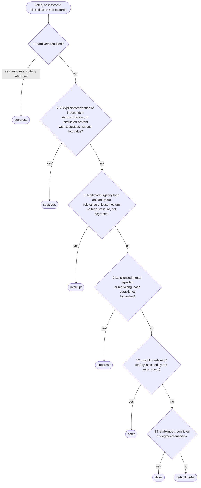

# Routing Policy

How exactly one action is selected. This document covers the ordered
policy; classification and features are in [architecture.md](architecture.md),
and risk findings are in [threat-model.md](threat-model.md).

This is a reference for the policy's design, not an evaluation. It reports no
accuracy, precision or recall, because the repository contains no labelled
real-world corpus to measure them against; what it does contain is a large
synthetic test suite that asserts the behaviour described below (see the
README's testing section for what that does and does not show).

## Ordered, first-match precedence

The policy is a list of rules evaluated top to bottom. The first rule whose
predicate holds selects the action and evaluation stops. The order is
declared as data (`POLICY_ORDER`), so it can be asserted directly rather
than inferred from behaviour.

| # | Policy ID | Action |
|---|---|---|
| 1 | `route.safety.hard_veto` | suppress |
| 2 | `route.risk.identity_credential_suppress` | suppress |
| 3 | `route.risk.payment_link_suppress` | suppress |
| 4 | `route.risk.advance_fee_pressure_suppress` | suppress |
| 5 | `route.risk.unusual_channel_suppress` | suppress |
| 6 | `route.risk.coercion_pressure_suppress` | suppress |
| 7 | `route.risk.propagation_low_value_suppress` | suppress |
| 8 | `route.urgency.safe_interrupt` | interrupt |
| 9 | `route.value.muted_low_value_suppress` | suppress |
| 10 | `route.value.repetitive_low_value_suppress` | suppress |
| 11 | `route.value.irrelevant_marketing_suppress` | suppress |
| 12 | `route.utility.safe_defer` | defer |
| 13 | `route.analysis.incomplete_defer` | defer |
| — | `route.default.defer` | defer |

The first rule whose predicate holds wins and evaluation stops. Every
suppression sits above the interrupt rule, and every deferral sits below it.

Every one of these is reachable by a real message through the real
pipeline, and a test asserts it. That is not a formality: an earlier
version of this table contained a rule requiring `high` manufactured
pressure, which only a *severe* finding could produce — and a severe
finding already vetoes one rule earlier. The rule read as a safeguard and
had never fired.

**There is no scoring in the policy.** No weighted sum, no point total, no
probability, no aggregate: rules compare qualitative levels and the first
match wins. A structural test parses every file in the `routing` package
and fails on addition, subtraction, multiplication or division, on a
`sum`, `max` or `min` call, and on identifiers such as `weight` or
`confidence`, because the moment features can be added together, a
sufficiently "positive" message can outweigh a risk — which is exactly the
failure this design exists to prevent.

The test covers the routing package only, and only those operations. Other
packages are not scanned for arithmetic, and one does some: the classifier
adds up small support ranks per candidate class to choose a class, with a
fixed tie-break (see [architecture.md](architecture.md)). That tally is an
internal step of classification, is not a routing score, and no action is
derived from it. The policy reads the chosen class and the qualitative
features, never the tally.

Qualitative levels do have an explicit ordering, used only for local
comparisons inside a single rule. `unknown`, `conflicted`, and `incomplete`
rank with `absent`: none is positive evidence, so none can satisfy a floor
that asks for support.

## Rule 1 — hard veto

When the safety layer reports `hard_veto_required`, the action is
`suppress` and **no later predicate is called at all**. That is what makes
the veto an obligation rather than a strong preference: trust, affinity,
urgency, relevance, usefulness, and classification are not weighed and
lost — they are never reached. A test replaces every later rule with a
tripwire that raises if invoked, and asserts none fires.

Severity and classification are not modified. Contributors record only the
safety finding, so nothing implies that mitigating features were considered
and outweighed.

## Rules 2–7 — suspicious combinations

Suspicious risk suppresses only in explicit conjunctions, and never by
mutating severity or fabricating a veto. A message suppressed here is still
`suspicious` afterwards, and `hard_veto_applied` is `false`.

The unit of corroboration is a **risk family**, projected from deduplicated
*root causes*. A root cause is the triple (risk family, safety rule
identifier, diagnostic code) — closed vocabularies only, never message text,
a URL, a transcript, or anything secret-bearing. Two findings that express
the same underlying indicator share a root cause and therefore count once,
so a single pattern cannot corroborate itself.

Provenance is deliberately **not** part of that key, and that is the whole
point. A caption and the image it was printed on are two sources, not two
reasons; the same demand read from authored text and from OCR is one cause.
There is no "a second modality agreed" family, because admitting one would
let a single indicator complete a two-family suppression by being read
twice. Cross-modal agreement between *different* causes is still recorded on
the feature bundle for auditability, and routing never reads it.

Evidence and corroboration credit are separate things: every finding
survives deduplication intact, keeps its own provenance, and is never
merged, dropped, or rewritten. Only the counting changes.

Each rule pairs an *anchor* family with a disjoint set of corroborating
families:

| Policy | Anchor | Corroborated by |
|---|---|---|
| `identity_credential` | identity inconsistency | information request, coercive payment, unusual channel, advance fee |
| `payment_link` | deceptive link | coercive payment, unusual channel, information request, advance fee |
| `advance_fee_pressure` | advance fee | pressure, coercive payment, unusual channel |
| `unusual_channel` | unusual payment channel | coercive payment, pressure |
| `coercion_pressure` | coercive payment | pressure |
| `propagation_low_value` | high circulation | established low relevance **and** utility, with suspicious risk |

At least one side must be **substantive**. Manufactured pressure and a
domain that merely looks wrong are corroborators: they strengthen a
substantive family and never combine into a suppression on their own.
Urgency wording is not a family at all — a countdown must not corroborate
itself — and neither is repetition across sources.

Only findings the safety layer reported as at least suspicious *and* not
ambiguous qualify, so a weak mention and a quoted or educational match never
accumulate. Alone, none of these suppresses: a weak finding, a single
suspicious indicator, an unverified domain, missing trust, or forwarding
metadata. An unresolved suspicious case falls through to deferral rather
than being forced either way.

## Rule 8 — safe interrupt

Interrupting requires *all* of:

* no hard veto and no suspicious suppression (guaranteed by precedence);
* legitimate urgency `high`;
* recipient relevance at least `medium`;
* malicious pressure not `high`;
* modality consistency not `conflicting`;
* completeness not materially degraded;
* the urgency not resting only on content the safety layer did not analyse.

None of these alone is enough. Shouting, punctuation, the isolated word
"urgent", direct targeting, high utility, affinity, and trust each fail to
interrupt on their own — verified individually across every feature level.
Malicious pressure can never support an interrupt.

Quiet hours, a silenced conversation, and interruption cost are recorded as
contextual contributors and deliberately do **not** block a genuinely
urgent message. Unknown trust does not block one either.

Urgency has to be *originated* by something independent: a safety alert, a
near-term event supplied as structured metadata, or a currently active
service disruption. Request grammar is not one of them. (Through the public
`route` command only the first and third origins can occur: the request
document has no field for a near-term event, so that origin is available to
callers of the library but not to the command line.) Being asked
something is not being asked something urgently, and treating a request as
urgency-bearing hands out priority for phrasing alone.

**Safety coverage.** The safety layer analyses at most 20,000 characters of
each source, but classification reads every source in full. A message can
therefore be classified as a safety alert, or as an active outage, purely
because of wording the safety layer never saw. The interrupt rule does not
accept that: if the `high` urgency level holds only because of such wording,
the rule does not fire, even though everything else would qualify. Wording
inside the analysed part counts as before, so a genuine alert near the start
of a very long message can still interrupt, and the unread remainder is
neither assumed safe nor assumed hostile. Structured context (a near-term
event, direct targeting) is not message content, so coverage does not apply
to it.

Only the interrupt is withheld. The reported classification, the `high`
urgency level and `analysis_incomplete` are unchanged, the hard veto still
runs first, and a severe finding inside the analysed part still suppresses.
The fact is an internal feature flag, not a new rule, policy identifier or
output field; the message simply falls through to the later rules and
usually defers.

Direct targeting **amplifies** urgency that already has an independent
basis and never originates it. With nothing to amplify it contributes no
urgency at all, so it cannot move `absent` to `low` or `unknown` to
established — it raises relevance, which is a different question.

The active-disruption signal is deliberately narrow, and is the only
classification rule a feature reads by identity. Scheduled maintenance, a
resolved incident, a retrospective, a rumour, documentation, and an
ordinary status update all fail it, because none of them is happening to
this reader right now.

## Rules 9–11 — low value

Explicit and narrow: a silenced conversation, heavy circulation, and
irrelevant marketing — each additionally requiring relevance *and*
usefulness to have been established as `low`. Most specific first, so a
general rule cannot shadow a narrower one into unreachability.

"Established" matters, and is checked by explicit equality against `low`
alone. `unknown` means context was never determined; `incomplete` and
`conflicted` mean the analysis behind it was degraded or disagreed;
`absent` is a statement about presence, not about value. None of them is a
finding of low value, and a suppression built on any of them would fire
whenever context happened to be missing. Relevance is established `low`
only where it was actually determined — an untargeted broadcast channel,
where both surface and targeting were consulted.

Urgency is treated as a *guard* here rather than as evidence: the rules
refuse to suppress anything with positive urgency support, without claiming
urgency was determined to be low.

Alone, none of these suppresses: a promotion, forwarding, a silenced
thread, quiet hours, or absent engagement. A useful promotion defers, a
silenced thread whose usefulness was never determined defers, and urgent
content in a silenced thread still interrupts.

## Rules 12–13 and the default — deferral

Safe content that is useful or relevant but not urgently so defers
(`route.utility.safe_defer`). Cases that are ambiguous, conflicted, or
built on degraded analysis defer with `route.analysis.incomplete_defer` —
the states that qualify are `incomplete_unavailable_backend`,
`incomplete_unsupported_media`, `incomplete_failed_analysis`, `conflicted`,
`insufficient_content`, and any conflicting or degraded modality
consistency.

Degraded analysis never suppresses and never interrupts on its own:
not knowing is a reason to wait, not a conclusion in either direction. A
reliable severe finding still reaches Rule 1 even when another source
failed.

Anything else defers by default, claiming nothing.

**Reading a deferral's contributors.** Every `route.utility.safe_defer`
decision lists a `legitimate_urgency` contributor with effect `prevented` and
the code `URGENCY_NOT_HIGH`. The code is a fixed label meaning "urgency did
not lead to an interrupt here"; it is attached whatever the urgency level
was, and it does not assert that the level is low. The `level` beside it is
the measured value and is the one to read. For example, an alert whose
interrupt was withheld for lack of safety coverage, or because its sources
conflicted, shows `level: high` with `URGENCY_NOT_HIGH`. The label was named
for the common case of a message that is simply not urgent.

## Classification independence

Classification is one contributor and is never mutated. No class is bound
to an action: the same class reaches `interrupt`, `defer`, and `suppress`
under different safety and feature states, and different classes share an
action. `suspicious_content` alone does not veto.

## Result contract

A result carries the action, one primary policy ID, ordered contributors,
`hard_veto_applied`, `analysis_incomplete`, and fixed diagnostic codes.
Contributors carry a family, a qualitative level, an effect (`supported`,
`prevented`, `contextual`), rule IDs, and a support source.

Deliberately absent: user-facing rationale, confidence, evidence
identifiers or ranking, probability, aggregate score, and any raw content,
URL, credential, payment, health, or path data. `serialize()` returns a
deterministic content-free view for exact comparison.

## Out of scope here

Evidence selection and ranking, rationale text, and confidence calibration.
The public decision exposes none of them. How the policy is reached from the
command line, with runnable examples, is described in [demo.md](demo.md).
